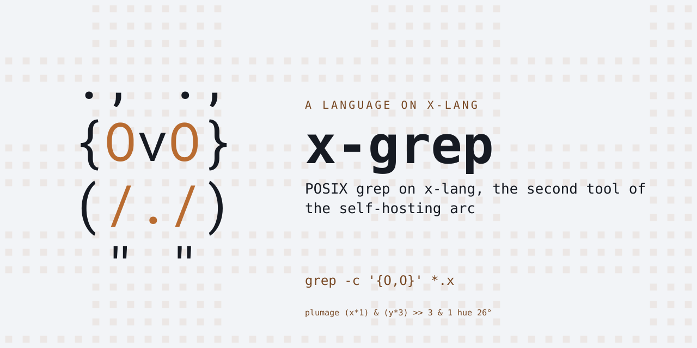
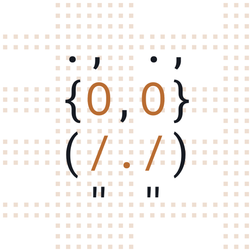

# x-grep — grep on x-lang

A grep written in [x-lang](https://github.com/jonruttan/x-lang), loaded as
a lang: basic and extended regular expressions and fixed strings, over
files or standard input.

    printf 'aa\nbb\n' | x -l grep 'a'
    x -l grep -- -in pattern file1 file2
    x -l grep -q needle haystack.txt; echo $?

It is the middle ground between GNU, BSD and BusyBox grep, on portable
idioms: where the three differ, the common ground of GNU and BSD wins.
The options and their help text follow BusyBox 1.36.1's grep, and every
spec expectation comes from a real grep run.

## Status

Pre-release: no release has been cut. Paired with x-lang v0.53.0
(`lang.xon` is the checkable row).

## What it does

- **Patterns.** BRE by default, translated onto x-lang's
  `lib/x/type/regex.x`: `\( \)` and `\{ \}`, and the `\| \+ \?` that GNU,
  BSD and BusyBox grep all take as operators, with the bare characters
  literal. `-E` for extended expressions, `-F` for fixed strings.
  `[:named:]` classes expand in both.
- **Options.** `-H -h -n -l -L -c -o -q -v -s -r -R -i -w -x -F -E`,
  `-m N`, and `-A`, `-B` and `-C N`, with bundled short flags and `--`.
- **Pattern collection.** `-e` and `-f`, any number of each; without
  them the first operand is the pattern.
- **Files.** Any number, with the name prefix when there is more than
  one; `-` and no file both read standard input.
- **Status.** 0 for a match, 1 for none, 2 for trouble.

## Differences and gaps

- **Back-references** are refused.
- **Leftmost-first matching**, where POSIX wants leftmost-longest. It does
  not change which lines are selected. It shows under `-o` when one
  alternative is a prefix of another: `-oE 'a|ab'` prints `a` where
  BusyBox prints `ab`.
- **Options come before the pattern.** They stop at the first operand.

## Install

It needs x-lang at the release `lang.xon` declares.

    make install        # into the x on PATH

## Running it

    x -l grep -- [-HhnlLcoqvsrRiwxFE] [-m N] [-A|B|C N] [-e pat]... [-f patfile]... [pat] [file]...

`--` ends x's own options, so grep's can follow it. A line with no
options of grep's needs no `--`.

[x-sed](https://github.com/jonruttan/x-sed) loads this bundle as a
library, for its BRE translation and its line reading.

## Development

    make test           # the suite
    make check          # the suite against tests/contract/known-failures.txt

`(grep-run ARGV INPUT-TEXT)` is the core, and the suite calls it
directly.

## Layout

    lang.xon          what the bundle is: lang, dialect, pairing, entry
    run.x             the entry
    grep/base.x       the parts, assembled
    grep/prims.x      the platform layer
    grep/bre.x        BRE, -i and [:classes:] as engine patterns; the -w, -x and -o loops
    grep/core.x       options, the line loop, the status
    grep/cli.x        standard input, and grep-main
    tests/            markdown specs, run by the platform's runner

## Licence

MIT No Attribution (MIT-0). See [LICENSE](LICENSE).

